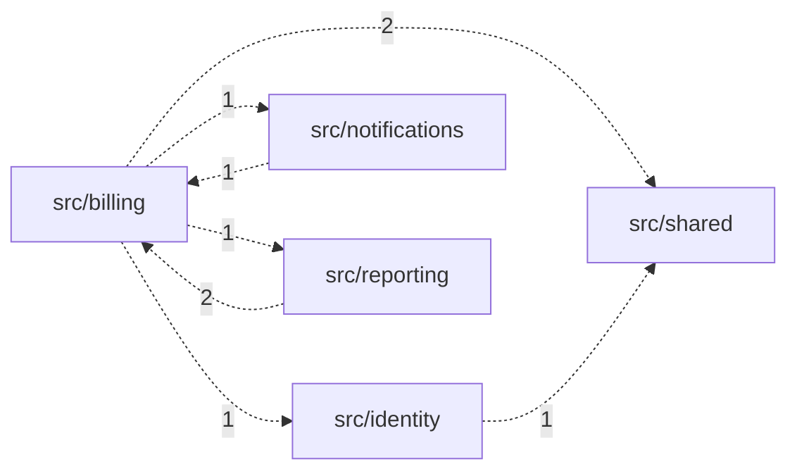

# Year-two architecture diagnostics: harborledger-demo

## Summary

Analyzed **292** commits (2024-07-01 to 2026-06-28). Coupling threshold: support >= 5, confidence >= 0.5; commits touching more than 30 files are ignored for coupling and churn.

Git history is a signal, not proof. This report is about modules and flows, not people: ownership is aggregated by team and must not be used to rate individuals or teams. See docs/limits.md.

- Strongest cross-module coupling: `src/billing/invoice.py` and `src/reporting/export.py` changed together in 30 commits (confidence 1.0).
- Top hotspot: `src/billing/invoice.py` (churn 84 x complexity 95.9 = 8055.6).
- Ownership bottleneck: `src/billing` is edited by 5 teams, and its owning team (billing) authors only 35% of the changes.
- Mutual dependency (cycle) between `src/billing` and `src/notifications`.
- Mutual dependency (cycle) between `src/billing` and `src/reporting`.

## Change coupling

File pairs that change in the same commit. *Cross-module* pairs are the expensive ones: one change needs coordination between two places. Confidence = co-changes / commits of the less-changed file.

| File A | File B | Co-changes | Confidence | Cross-module | Cross-team |
|---|---|---|---|---|---|
| src/billing/invoice.py | src/reporting/export.py | 30 | 1.0 | yes | yes |
| src/billing/invoice.py | src/identity/authz.py | 14 | 1.0 | yes | yes |

**Module pairs (commits touching both)**

| Module A | Module B | Commits | Confidence |
|---|---|---|---|
| src/billing | src/reporting | 30 | 0.38 |
| src/billing | src/identity | 14 | 0.23 |

## Hotspots

Churn (commits touching the file) multiplied by a simple complexity proxy (branch keywords + non-blank lines / 20). Frequently changed *and* hard to change is where risk concentrates.

| File | Team | Churn | LOC | Branches | Complexity | Score |
|---|---|---|---|---|---|---|
| src/billing/invoice.py | billing | 84 | 178 | 87 | 95.9 | 8055.6 |
| src/identity/accounts.py | identity | 31 | 64 | 0 | 3.2 | 99.2 |
| src/reporting/export.py | reporting | 30 | 63 | 0 | 3.1 | 93.0 |
| src/reporting/read_models.py | reporting | 29 | 61 | 0 | 3.0 | 87.0 |
| src/shared/logging_utils.py | platform | 29 | 60 | 0 | 3.0 | 87.0 |
| src/reporting/schedule.py | reporting | 27 | 56 | 0 | 2.8 | 75.6 |
| src/shared/config.py | platform | 27 | 56 | 0 | 2.8 | 75.6 |
| src/identity/session.py | identity | 25 | 53 | 0 | 2.6 | 65.0 |
| src/notifications/retry.py | notifications | 20 | 43 | 0 | 2.1 | 42.0 |
| src/notifications/channels.py | notifications | 18 | 38 | 0 | 1.9 | 34.2 |

## Ownership by team

Counts are aggregated per team; individuals are never listed. A module edited by many teams, where the owning team authors a minority of changes, is a likely queue: changes wait for someone else's context or review.

| Module | Owner team | Commits | Teams touching | Owner share | Bottleneck |
|---|---|---|---|---|---|
| src/billing | billing | 98 | 5 | 35% | YES |
| src/reporting | reporting | 78 | 5 | 71% | no |
| src/identity | identity | 62 | 4 | 82% | no |
| src/notifications | notifications | 48 | 4 | 92% | no |
| src/shared | platform | 48 | 3 | 94% | no |

**Teams**

| Team | Commits authored | Authors (count) | Cross-team commit share | Inbound share on its files |
|---|---|---|---|---|
| billing | 36 | 3 | 42% | 65% |
| reporting | 64 | 3 | 31% | 29% |
| identity | 72 | 3 | 35% | 18% |
| notifications | 61 | 3 | 28% | 8% |
| platform | 57 | 3 | 21% | 6% |

**Cross-team change flows (author team -> owning team)**

| From team | To team | Commits |
|---|---|---|
| identity | billing | 23 |
| reporting | billing | 18 |
| notifications | billing | 15 |
| identity | reporting | 9 |
| platform | billing | 8 |
| billing | reporting | 7 |
| billing | identity | 6 |
| notifications | reporting | 4 |
| notifications | identity | 3 |
| platform | reporting | 3 |

## Dependency map

Module-to-module imports found by static scanning (Python and JS/TS). Dashed arrows cross team boundaries. Mutual dependencies: `src/billing` <-> `src/notifications`, `src/billing` <-> `src/reporting`.

| From | To | Imports | Cross-team | Mutual |
|---|---|---|---|---|
| src/billing | src/identity | 1 | yes | no |
| src/billing | src/notifications | 1 | yes | yes |
| src/billing | src/reporting | 1 | yes | yes |
| src/billing | src/shared | 2 | yes | no |
| src/identity | src/shared | 1 | yes | no |
| src/notifications | src/billing | 1 | yes | yes |
| src/reporting | src/billing | 2 | yes | yes |

